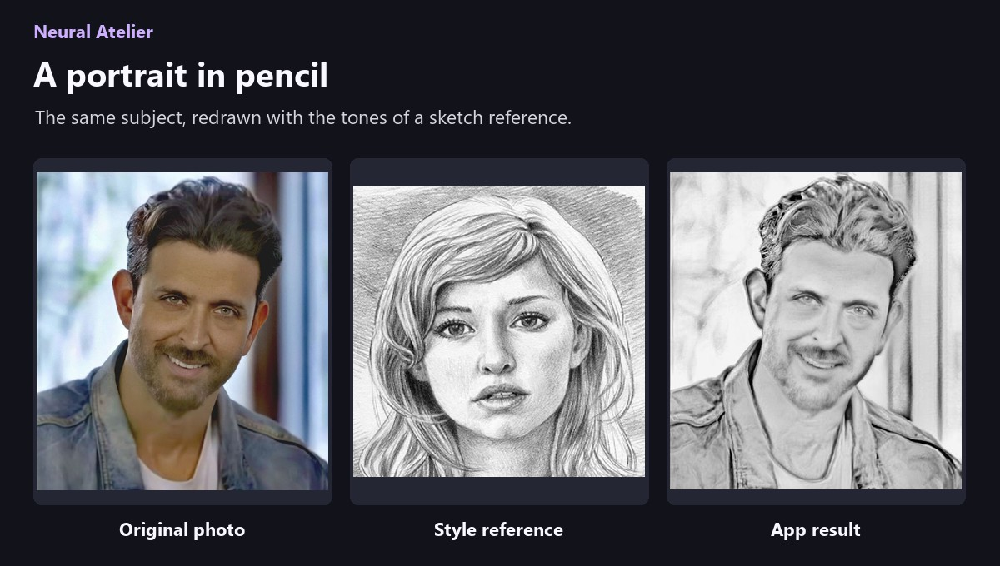

# Neural Atelier

*See yourself through an artist’s eyes.*

Turn a photo into a pencil portrait or a painting using a reference image. Neural Atelier pairs **AdaIN style transfer in PyTorch** with a **Flask** interface. Two controls let you change the strength of the artwork and the amount of facial detail restored from the photo.



[See the painting example](demo/painting-preview.jpg) · [Run locally](#run-locally)

## Run locally

Tested on **64-bit Windows, Python 3.14.4 and CPU**. Download and extract the repository, or clone it. Open PowerShell in the folder containing `app.py` and run:

```powershell
py -3.14 -m venv .venv
.\.venv\Scripts\python.exe -m pip install -r requirements.txt
.\.venv\Scripts\python.exe -m pip check
.\Start_NST.cmd
```

Open **http://127.0.0.1:5000/** when Flask prints its local address. On later runs, double-click `Start_NST.cmd`. Keep the console open while using the app and press Ctrl+C to stop it. The app selects CUDA when the installed PyTorch build and hardware support it. The training datasets are optional for inference.

### Reproduce the preview

1. Upload `examples/i_p_Hrithik Roshan.jpg` as the content photo and `examples/style1.png` as the style reference. Both inputs accept JPG, JPEG or PNG.
2. Select **Preserve face detail** and submit. This preset uses **80% style strength** and **70% facial detail preservation**. Use **Download Result** below the preview to save the image.
3. Switch the reference to `examples/style2.jpg` for the painting example. For a softer result, deselect the preset and set style strength to **35%** and facial detail to **70%**. Both sliders span 0–100%.

### Model weights

The inference bundle includes all three files below. Keep their paths relative to `app.py` when copying the project. The app loads the encoder and baseline decoder at startup, then loads the step-200 decoder on the first preset or manual transfer.

| File | Used for |
| --- | --- |
| `vgg_normalised.pth` | Frozen VGG encoder that extracts content and reference features |
| `experiment/final_exp/decoder_final.pth` | Original app decoder, baseline for training and older single-alpha requests |
| `experiment/pilot_600/decoder_step_000200.pth` | Fine-tuned decoder used by the portrait preset and both manual controls |

For a missing-file or weight-loading error, run `py -3.14 scripts/check_weights.py` from the project root. It checks each file against the SHA-256 digest of the weights used for the previews and reports the affected path. Restore that file from the project bundle, then restart the app.

## How the transfer works

The encoder extracts features through VGG’s `relu4_1` layer. Adaptive instance normalization (AdaIN) adjusts each content feature channel to the mean and standard deviation of the corresponding reference channel. Style strength blends the adjusted features with the original features, and the decoder turns the blend back into an image.

For portraits, OpenCV detects frontal or profile faces. A soft mask restores fine brightness detail around detected faces while keeping the colors of the stylized image. A bright, near-monochrome reference also activates pencil shading. If face detection misses a subject, the style still transfers but the facial-detail slider has no local effect. A setting of 70% is a blending weight, not a measured identity-retention score.

## Training and checkpoint selection

The decoder was fine-tuned on **40,667 photos and 11,022 paintings** with batch size 4 and learning rate `1e-5`. The run completed one content epoch (10,167 optimizer steps). Three fixed photo–style pairs tracked portrait, landscape and architectural detail throughout training.

| Decoder | Mean weighted validation loss ↓ |
| --- | ---: |
| Original app baseline | 2.7085 |
| Step 200, used for portraits | **2.5243** |
| Step 10,167, end of epoch | 2.7422 |

Step 200 had the lowest mean on these three pairs. This comparison measures decoder loss on the fixed validation set. The README previews show the final app output, including portrait processing. Training commands, checkpoint resume and the validation protocol are in [TRAINING.md](TRAINING.md).

## Project layout

| Path | Contents |
| --- | --- |
| `app.py`, `templates/` | Flask upload, inference, preview and download flow |
| `utils/models.py`, `utils/utils.py` | Encoder, decoder, AdaIN and portrait processing |
| `train.py`, `utils/validation.py`, `validation/` | Fine-tuning, checkpoint comparison and fixed validation pairs |
| `examples/`, `demo/` | Sample inputs, gallery outputs and previews |
| `requirements.txt`, `Start_NST.cmd` | Tested Python packages and Windows launcher |

**Author** · MD Kaif
